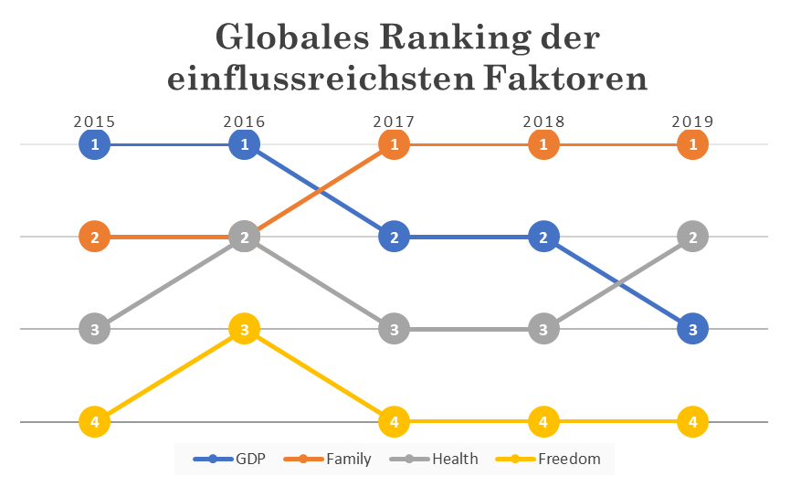
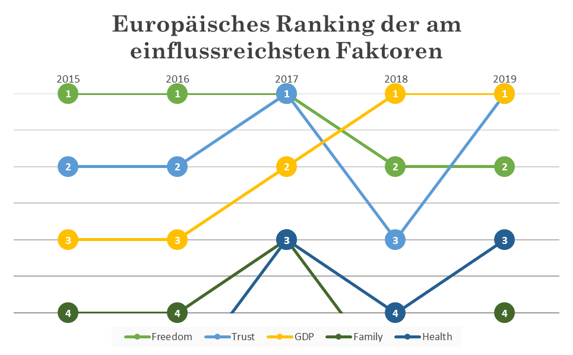
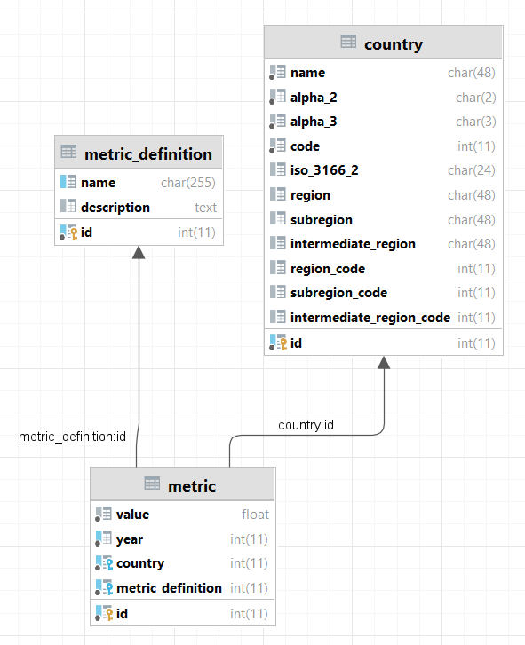

# What makes people happy? A data-driven analysis of the World Happiness Report


A business intelligence case study. We combined the **World Happiness Report (2015–2023)** with ten additional country indicators in a relational database, then used **correlation analysis, PCA and K-Means clustering** to find which factors are most closely linked to life satisfaction, globally and by continent.

- [Case study (PDF, German)](docs/case-study.pdf)
- [Presentation slides (PDF, German)](docs/presentation.pdf)

---

## Business question

The fictional company *BeHappy! AG* wants to develop new products based on what drives people's satisfaction. The case study follows Bernard Marr's *five-step approach to data-driven decision-making* and answers two research questions:

1. Which World Happiness Report indicators are most strongly related to a population's life satisfaction?
2. Do these indicators differ between regions and continents?

## Key findings

| Scope | Most influential factors |
|---|---|
| **Global** | Social support ("family"), healthy life expectancy, GDP per capita |
| **Africa** | Social support, then GDP per capita and life expectancy |
| **Americas** | GDP per capita at first, increasingly replaced by health and social support |
| **Asia** | GDP per capita, closely followed by social support and health |
| **Europe** | Freedom to make life choices, trust in government, GDP per capita |

Material footprint, forest area and inflation showed almost no relationship with life satisfaction.

<p>
  
  
</p>

## Approach

```
CSV / XLSX sources ──► Jupyter ETL notebooks ──► MariaDB (normalised schema) ──► SQL + pandas ──► correlation, PCA, K-Means ──► charts
```

1. **Data collection:** World Happiness Report (one file per year) and ten additional country indicators (e.g. CO₂ consumption, homicide rate, inflation, political system).
2. **Data modelling:** the source files use three different layouts and change their column names from year to year. Everything is converted into one normalised schema: `country`, `metric_definition` and `metric`.
3. **ETL:** Python notebooks clean the data (e.g. `12k` → `12000`, Unicode minus signs, inconsistent country names) and load it into MariaDB.
4. **Analysis:** Pearson correlation matrices per year and continent, plus PCA and K-Means clustering of countries.
5. **Presentation:** heatmaps, ranking charts and a choropleth world map (Plotly).



## Repository structure

```
├── code/
│   ├── bina_db.py                              # Shared DB connection and country-name mapping
│   ├── datenaufbereitung-whr.ipynb             # ETL: World Happiness Report
│   ├── datenaufbereitung-additional.ipynb      # ETL: additional indicators
│   ├── datenaufbereitung-political-regime.ipynb# ETL: political system
│   ├── walkthrough-pearson-corr.ipynb          # Step-by-step correlation example
│   ├── korrelationsanalyse.ipynb               # Correlation by region
│   ├── visualisierung.ipynb                    # PCA + K-Means clustering
│   └── visualisierung_globus.ipynb             # Choropleth world map
├── data/
│   ├── worldhappinessreport/                   # WHR 2015–2023
│   ├── additional/                             # Additional indicators
│   └── supplemental/                           # ISO-3166 country list with regions
├── db/schema.sql                               # Database schema (MariaDB)
├── docs/                                       # Case study, slides, images
└── output/                                     # Generated heatmaps and cluster plots
```

## Running it locally

```bash
pip install -r requirements.txt
mysql -u root -p < db/schema.sql      # create the database
cp .env.example .env                  # then set your own credentials
set -a; source .env; set +a           # export them for Jupyter
jupyter notebook code/
```

Run the `datenaufbereitung-*` notebooks first to fill the database, then the analysis notebooks.

## Known limitations

- **The 2015 file is a copy of the 2020 report.** `data/worldhappinessreport/2015.csv` has the same content as `2020.csv`, so the 2015 results in the charts are based on 2020 data. The 2016–2019 results are not affected.
- **The `country` table was filled once by hand.** It came from `data/supplemental/countries-extended.csv` with manual name adjustments. Those adjustments are not part of the repository.
- **The analysis notebooks refer to metrics by their database IDs.** The heatmaps in `output/` are therefore labelled with IDs, not names.

## Team & context

| | |
|---|---|
| **Programme** | M.Sc. Business Information Systems (Wirtschaftsinformatik) |
| **Module** | Business Intelligence & Analytics, spring semester 2024 |
| **Authors** | Annamária Sréter, Pjeter Bushi |

## Data sources

- [World Happiness Report](https://worldhappiness.report/)
- [World Bank Open Data](https://data.worldbank.org/indicator) (additional indicators, as cited in the case study)
- [ISO-3166 Countries with Regional Codes](https://github.com/lukes/ISO-3166-Countries-with-Regional-Codes) (country list)

The datasets remain under the licences of their respective providers.
