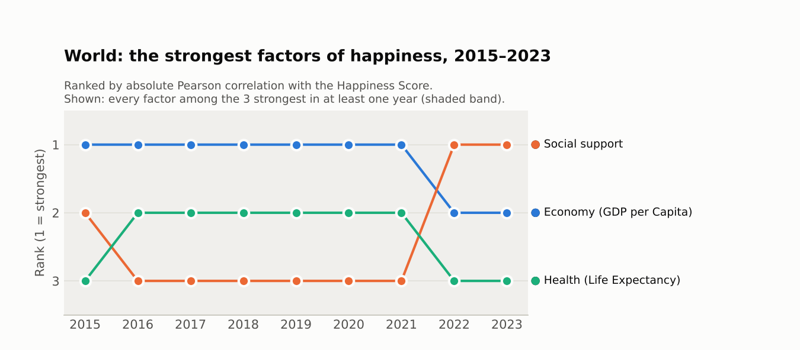
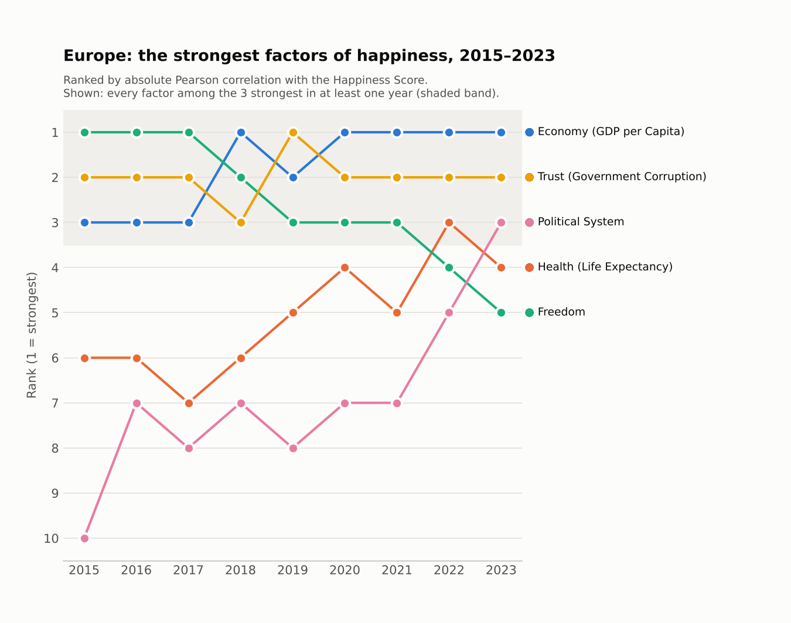

# What makes people happy? A data-driven analysis of the World Happiness Report


A business intelligence case study. We combined the **World Happiness Report (2015–2023)** with ten additional country indicators in a relational database, then used **correlation analysis, PCA and K-Means clustering** to find which factors are most closely linked to life satisfaction, globally and by continent.

- [Case study (PDF, German)](docs/case-study.pdf)
- [Presentation slides (PDF, German)](docs/presentation.pdf)

---

## Business question

The fictional company *BeHappy! AG* wants to develop new products based on what drives people's satisfaction. The case study follows Bernard Marr's *five-step approach to data-driven decision-making* and answers two research questions:

1. Which World Happiness Report indicators are most strongly related to a population's life satisfaction?
2. Do these indicators differ between regions and continents?

## Key findings

Reproduced with `pipeline/` for 2015–2019 (the period of the case study). Factors are ranked by their absolute Pearson correlation with the Happiness Score.

| Scope | Most influential factors |
|---|---|
| **Global** | GDP per capita (r ≈ 0.79–0.81), healthy life expectancy and social support (both r ≈ 0.73–0.78) |
| **Africa** | GDP per capita and social support, together with the sustainable development index |
| **Americas** | GDP per capita at first, replaced from 2017 by healthy life expectancy and, from 2018, freedom |
| **Asia** | GDP per capita, closely followed by social support and health |
| **Europe** | Freedom to make life choices and trust in government, with GDP per capita moving up from 2018 |

Material footprint, consumption-based CO₂ emissions and forest area showed almost no relationship with life satisfaction (|r| ≤ 0.16 globally).

The reproduced results confirm the three global factors and the patterns for Africa, Asia and Europe, but differ from the original 2024 case study in detail (GDP per capita, not social support, ranks first globally up to 2021; in the Americas freedom rather than social support follows health; inflation is not among the weakest factors), and the cause cannot be traced because the hand-filled database of the original analysis is not part of the repository.

<p>
  
  
</p>

The ranking charts of the original case study are in `docs/images/`.

## Approach

```
CSV sources ──► pipeline/build_database.py ──► SQLite (normalised schema) ──► pipeline/analyze.py ──► correlation, PCA, K-Means ──► results/
```

The original 2024 workflow used Jupyter notebooks and a MariaDB server (`code/`). The same steps now run as a small Python package (`pipeline/`) on an SQLite file, so the analysis can be reproduced with one command and without a database server.

1. **Data collection:** World Happiness Report (one file per year) and ten additional country indicators (e.g. CO₂ consumption, homicide rate, inflation, political system).
2. **Data modelling:** the source files use three different layouts and change their column names from year to year. Everything is converted into one normalised schema: `country`, `metric_definition` and `metric`.
3. **ETL:** the data is cleaned (e.g. `12k` → `12000`, Unicode minus signs) and every country name is matched to an ISO-3166 country before it is loaded into the database.
4. **Analysis:** Pearson correlation of every indicator with the Happiness Score per year and continent, plus PCA and K-Means clustering of countries.
5. **Presentation:** ranking charts, correlation heatmaps and a cluster plot (the original notebooks also drew a choropleth world map with Plotly).


## Quick start

```bash
pip install -r requirements.txt
python -m pipeline.build_database   # data/ -> bina.sqlite (about 3 seconds)
python -m pipeline.analyze          # bina.sqlite -> results/ (about 15 seconds)
python -m pytest -q                 # optional: tests
```

`make` runs the first two steps and `make test` the tests. Python 3.10 or newer is required.

### pipeline/

- `build_database.py` builds `bina.sqlite` with the three tables of `db/schema.sql` (`country`, `metric_definition`, `metric`). It reads the ISO country list, the World Happiness Report 2015–2023 and the ten additional indicators, unifies the column names of the different report years and prints the number of countries per year and every country name it could not match.
- `countries.py` matches the country names of all sources to ISO alpha-3 codes (codes where a file has them, otherwise an alias table and the ISO name).
- `analyze.py` computes the correlations, rankings and clusters; `charts.py` draws the charts.

Choices that affect the numbers:

- **One definition of the WHR factors for all years.** 2015–2019 only publish how much each factor contributes to the score. From 2020 on, the reports contain both raw values (e.g. "Logged GDP per capita") and these contributions ("Explained by: …"); the pipeline uses the contributions throughout. "Family" (2015–2017) is treated as "Social support".
- **Missing values are left out** pairwise; a correlation needs at least 15 countries. The original notebooks replaced missing values with 0.
- **Factors are ranked by absolute correlation** (1 = strongest). The Dystopia residual is not ranked, because it is the part of the score that the WHR model does not explain.
- **Continents** follow the `region` column of the ISO list (Africa, Americas, Asia, Europe). Oceania has too few countries.
- **Clustering** uses 2019, the last year before the pandemic with almost all indicators: min-max scaling, PCA with two components, K-Means with k = 3 and a fixed random state.

### results/

| File | Content |
|---|---|
| `correlations.csv` | r, number of countries and rank of every indicator, per scope (World and continents) and year, 2015–2023 |
| `summary.json` | top 3 and bottom 3 factors per scope and year, number of countries, cluster summary |
| `ranking-top3-<scope>.png` | rank of the strongest factors per year (like figures 18 and 20–23 of the case study) |
| `ranking-bottom3-world.png` | rank of the weakest factors, 2015–2019 (like figure 19) |
| `heatmap-<scope>-2019.png` | correlation matrix of all indicators, labelled with names |
| `pca-kmeans-2019.png`, `.csv` | countries on the first two principal components, coloured by cluster |

## Repository structure

```
├── pipeline/                                   # Reproducible pipeline: build database, analyse, chart
├── tests/                                      # Tests for value conversion, column and country matching
├── results/                                    # Output of the pipeline
├── code/
│   ├── bina_db.py                              # Shared DB connection and country-name mapping
│   ├── datenaufbereitung-whr.ipynb             # ETL: World Happiness Report
│   ├── datenaufbereitung-additional.ipynb      # ETL: additional indicators
│   ├── datenaufbereitung-political-regime.ipynb# ETL: political system
│   ├── walkthrough-pearson-corr.ipynb          # Step-by-step correlation example
│   ├── korrelationsanalyse.ipynb               # Correlation by region
│   ├── visualisierung.ipynb                    # PCA + K-Means clustering
│   └── visualisierung_globus.ipynb             # Choropleth world map
├── data/
│   ├── worldhappinessreport/                   # WHR 2015–2023
│   ├── additional/                             # Additional indicators
│   └── supplemental/                           # ISO-3166 country list with regions
├── db/schema.sql                               # Database schema (MariaDB, used by the notebooks)
├── docs/                                       # Case study, slides, images
├── output/                                     # Charts of the original 2024 notebooks
├── Makefile
└── requirements.txt
```

## Original notebooks

The notebooks in `code/` document the original 2024 workflow and are kept unchanged. They need a MariaDB server:

```bash
pip install -r requirements-notebooks.txt
mysql -u root -p < db/schema.sql      # create the database
cp .env.example .env                  # then set your own credentials
set -a; source .env; set +a           # export them for Jupyter
jupyter notebook code/
```

The `country` table then has to be filled from `data/supplemental/countries-extended.csv` before the `datenaufbereitung-*` notebooks are run. The analysis notebooks refer to metrics and countries by the IDs of the original database, so their results depend on the order in which the data was loaded.

## Known limitations

- **The charts in `output/` come from the original notebooks.** They are labelled with database IDs, treat missing values as 0, and their 2015 charts are based on a copy of the 2020 report that was stored as `2015.csv` at the time. The file has since been replaced by the genuine 2015 report; `results/` contains the reproduced charts.
- **Not every indicator covers the analysis period.** Cars, trucks and buses per 1000 persons only has data for 2002–2007 and therefore never enters the analysis. The homicide rate ends in 2016 (and has too few countries in 2016 for most scopes), material footprint and the sustainable development index end in 2019. The ranking of the weakest factors is therefore only shown for 2015–2019.
- **CO₂ emissions and material footprint are country totals**, not values per person (despite the file name `material_footprint_per_capital.csv`). Their weak correlation with happiness partly reflects country size.
- **Countries without an ISO-3166 entry are left out:** North Cyprus and Somaliland (WHR), the Channel Islands, and historical states. Kosovo is added to the country list with the code XKX.
- **Correlation is not causation.** The six WHR factors are the report's own explanation of the score, so their strong correlation with it is partly by construction.
- The two `.xlsx` files in `data/additional/` (climate change as a threat, surface area) were not among the ten indicators of the case study and are not used.

## Team & context

| | |
|---|---|
| **Programme** | M.Sc. Business Information Systems (Wirtschaftsinformatik) |
| **Module** | Business Intelligence & Analytics, spring semester 2024 |
| **Authors** | Annamária Sréter, Pjeter Bushi |

## Data sources

- [World Happiness Report](https://worldhappiness.report/). `2015.csv` is the 2015 table of the Kaggle dataset "World Happiness Report" (Sustainable Development Solutions Network), taken from the public mirror [ModelOriented/modelStudio](https://github.com/ModelOriented/modelStudio/blob/master/data-raw/2015.csv) and checked against five other independent copies (identical) and the published 2015 ranking (158 countries; Switzerland 7.587, Iceland 7.561, Denmark 7.527).
- [World Bank Open Data](https://data.worldbank.org/indicator) (additional indicators, as cited in the case study)
- [ISO-3166 Countries with Regional Codes](https://github.com/lukes/ISO-3166-Countries-with-Regional-Codes) (country list)

The datasets remain under the licences of their respective providers.
